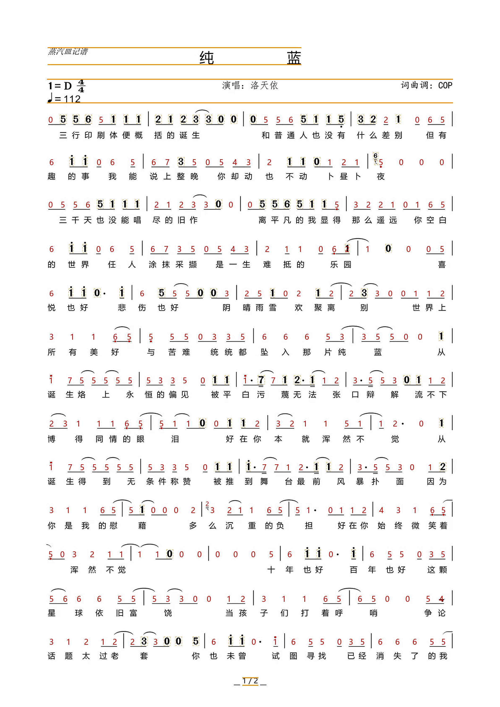

# 简谱转调工作台（Jianpu Fixed-Do Workbench）

把**首调简谱（1=D 之类）**整页就地改成**固定调（1=C）**的红字图：原版面（反复记号、
一行两段歌词、D.S.、速度标记）全部保留，只把数字音符替换成转调后的红字。
带一个本地纠错台：点音符改数字、拖框加强识别、点橙框回填、中途转调打点、识别强度三档。

> 不是「重排一份谱」，而是「在原图上就地替换」。所以排版不会崩、歌词不会错位。



---

## 它能干什么

- **整页转调**：`1=D → 1=C`，逐音换算到绝对音高、再落到目标调；八度点跟着原谱走。
- **保留版面**：只在原字形位置画红字，反复/跳房子/一行两段歌词/小节线全不动。
- **橙框 = 没识别**：没配上数字的墨块画橙框，点一下填数字；也能框选「加强识别 / 清空」。
- **中途转调**：在谱面上点一个锚点（吸附到最近一行、行首点击=整行起转），之后按新调。
- **识别强度三档**：严格（只信 OCR 文本）/ 标准（数字框补充）/ 加强（几何分类器补齐）。
- **乐谱库**：导入文件夹或图片、自动分份、AI 认歌名（可选、只发文字）、垃圾箱、去重。
- **人工导入**：不跑 OCR 也不调 AI，填个谱名 + 调号 + 选图就能进库，进去自己点音符。
- **修正记录**：每次改动（含坐标、行基线、邻音间距）都记下来，攒成自学习数据集。

## 流程

```
导入 → 本地库 → OCR 取文字(本地) → AI 认歌名/分份 → 版面几何 → 数字识别
     → 文本↔版面 对齐 → 转调 → 渲染出图 → 纠错 / 批量导出
```

**核心思想：一份谱 = 一段文字（OCR）+ 一套几何（版面）的双流对齐。**

| 环节 | 用什么 |
|---|---|
| OCR | 本地 `llama.cpp` + [Xiaomi-OCR-0](https://huggingface.co/SeerRay-Lab/Xiaomi-OCR-0)（GGUF，可选），兜底 `rapidocr-onnxruntime` |
| 版面几何 | OpenCV（Otsu、连通域、形态学）+ numpy |
| 数字识别 | 自训 GlyphNet（ONNX，`onnxruntime`） |
| 对齐 | 自写单调 DP（`jp/align.py`），按音符或按小节锚定 |
| 渲染 | Pillow（ImageDraw + FreeType） |
| 纠错台 | 标准库 `http.server` + 原生 JS canvas |
| 认歌名 | DeepSeek API（`/chat/completions` + `/v1/tools/search`），**只发 OCR 文字，不发图** |

详细设计（含踩过的坑和实测数字）：[`work/ROI工具需求与设计.md`](work/ROI工具需求与设计.md)

## 快速开始

```powershell
python -m venv E:\jianpu-env\venv
E:\jianpu-env\venv\Scripts\pip install -r requirements.txt

# 生成内嵌页面（改了 work\roi_page.html 之后要跑一次）
E:\jianpu-env\venv\Scripts\python work\gen_page.py

# 启动（单实例！端口被占会连到旧代码，一定要先杀干净）
E:\jianpu-env\venv\Scripts\python -m jp.roi_server --port 8769
```

- 乐谱库：<http://127.0.0.1:8769/lib>
- 纠错台：<http://127.0.0.1:8769/>（从库里点「打开纠错」进入）

### 可选：本地 OCR

`jp/xiaomi_ocr.py` 默认找 `E:\jianpu-env\ocr\`，可用环境变量覆盖：

```
XIAOMI_OCR_HOME   llama.cpp 目录 + model 目录的父目录
XIAOMI_OCR_BIN    默认 llama-cuda（CPU 用 llama）
```

需要 `llama-mtmd-cli.exe`、`model/Xiaomi-OCR-0.Q4_K_M.gguf`、`model/mmproj-bf16.gguf`。
没有也能用：**人工导入**完全不需要 OCR。

## 目录

```
jp/
  roi_server.py     HTTP 服务 + 纠错台后端（State/渲染/编辑/转调/强度）
  library.py        乐谱库（library.json + library/<id>/）、导入、分份、去重
  core.py           版面几何（二值化/连通域/拆合字形/找行）
  align.py          文本↔版面 单调 DP 对齐
  merge_octave.py   全页对齐主流程（含识别强度、兜底补字）
  emit_fixed.py     渲染（擦原字 + 红字 + 八度点 + 橙框）
  music.py          音级/绝对音高/转调换算
  glyphnet.py       ONNX 字形分类器
  train_glyph.py    字形分类器训练（按小节自动对齐生成标签）
  edits.py          修正记录（自学习数据集）
  xiaomi_ocr.py     本地 OCR 调用 + 简谱文本解析
  ocr_boxes.py      RapidOCR 带框结果（数字兜底/ROI 重识别）
work/
  gen_page.py       把 roi_page.html 内嵌进 roi_server.PAGE
  roi_page.html     纠错台前端
  lib_page.html     乐谱库前端
  ROI工具需求与设计.md
```

## 已知限制

- 只处理**数字简谱**（1-7 + 八度点 + 升降号），不是五线谱。
- 版面里的特殊记法（装饰音、连音线内的细分）可能留橙框，需要人工点。
- GPU 只为本地 OCR 服务；GTX1650 4G 上**必须独占显存**，多开反而慢 5–10 倍。
- 在线识别歌名需要自己的 DeepSeek Key（设置 → AI 配置），不配也能用人工导入。

## 许可

MIT，见 [LICENSE](LICENSE)。

第三方：Xiaomi-OCR-0（模型权重遵循其原始许可）、RapidOCR（Apache-2.0）、
llama.cpp（MIT）、OpenCV（Apache-2.0）、Pillow（HPND）。
